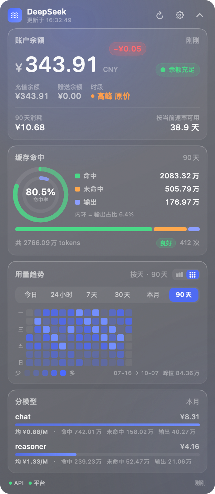
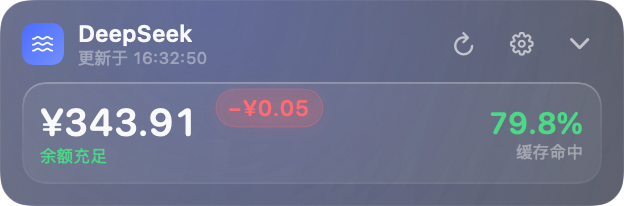
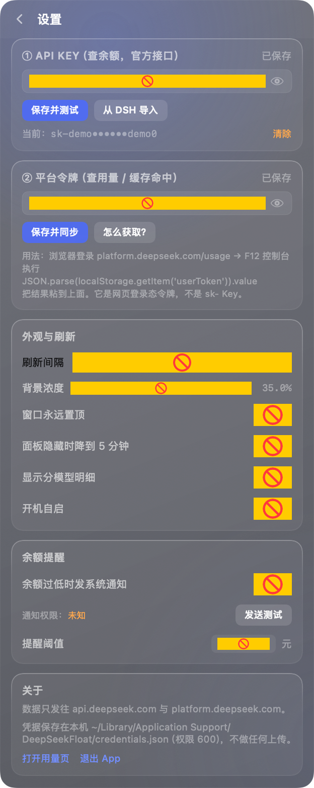
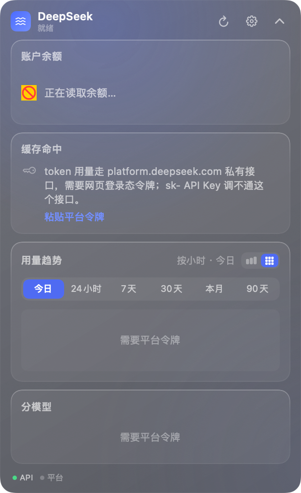

# DeepSeek 悬浮窗 · DeepSeekFloat

一个原生 macOS **桌面悬浮小窗**（不是菜单栏弹窗、也不是浏览器插件）：输入 DeepSeek API Key 即可看到账户余额；再补一个平台令牌，就能看到实时 token 用量、**缓存命中率**、消费金额与分模型明细。

无边框毛玻璃、永远置顶、可拖动、跨所有桌面空间、不进 Dock，菜单栏常驻余额。



---

## 一、先说清楚一件事：**API Key 查不到用量**

这不是配置问题，是接口设计如此。DeepSeek 目前只有两个数据面：

| 数据 | 接口 | 认什么凭据 | 状态 |
|---|---|---|---|
| 账户余额（总额 / 充值 / 赠送 / 可用状态） | `GET api.deepseek.com/user/balance` | `sk-` API Key | **官方公开接口**，[文档在此](https://api-docs.deepseek.com/zh-cn/api/get-user-balance/) |
| token 用量 / 缓存命中 / 消费 / 分模型 | `platform.deepseek.com/api/v0/usage/*` | 网页登录态 `userToken` | **网页私有接口**，未公开、可能随时变 |

拿 `sk-` Key 去调平台用量接口，会稳定返回业务错误码 `40003 invalid token`。两个同生态的开源实现（[dsh-usage](https://github.com/Huasecc/dsh-usage)、[dsh-deepseek-usage](https://github.com/AzureHalcyon/dsh-deepseek-usage)）都踩过同一个坑，结论一致。

所以本工具做成**两条互相独立的通路**，任意一条失败都不影响另一条：

- **通路 ①（必需，10 秒配好）**：粘贴 `sk-` Key → 立刻有余额、可用状态、低余额告警、消耗速率与可用天数估算。
- **通路 ②（可选，1 分钟配好）**：粘贴平台 `userToken` → 才有 token 用量、缓存命中率、消费、分模型。

只配 ① 也能正常用，只是用量卡片会明确告诉你缺什么，而不是假装有数据。

---

## 二、安装与运行

**环境要求**：macOS **14+** / Apple Silicon。只需要 Xcode Command Line Tools（`xcode-select --install`），**不需要完整 Xcode**——本机实测 Swift 6.1.2 + CommandLineTools 可直接编译。

> 部署目标从 13.0 提到了 **14.0**，因为用到了 `contentTransition(.numericText())`、`KeyframeAnimator`、`symbolEffect` 等 macOS 14 才有的动效 API（这些都已在本机实测编译通过）。macOS 26 的 Liquid Glass 材质用不了——CommandLineTools 附带的 SDK 是 15.5，不含相关符号，需要装完整 Xcode 26。

```bash
cd DeepSeekFloat

./build.sh install   # 编译 + 安装到 /Applications + 启动（正式用法）
./build.sh status    # 查看安装 / 运行 / 开机自启 / 通知权限 / 凭据状态
./build.sh uninstall # 卸载；加 --purge 连凭据与偏好一起删

./build.sh run       # 编译后从 build/ 启动（开发用，不装）
./build.sh test      # 编译并跑全部 76 项断言
./build.sh package   # 生成可分发的 zip（本机自用其实不需要）
./build.sh icon      # 重新生成 Resources/AppIcon.icns
./build.sh clean     # 清理 build/
```

`install` 做的事：编译 → 退掉正在运行的旧实例 → `ditto` 到 `/Applications`（保留签名）→ 去隔离属性 → `lsregister` 主动登记 LaunchServices → 校验签名 → `open` 启动。

**为什么必须用 `install` 而不是 `run`**：`SMAppService`（开机自启）要求系统认得这个 bundle，从 `build/` 里跑会直接报 `系统找不到该 App`。已实测：装到 `/Applications` 后注册/注销都能成功。

卸载：`./build.sh uninstall` 会先注销开机自启再删 App（顺序反了会留下一个每次开机都失败的登录项）；凭据与偏好默认保留，要清干净加 `--purge`。

产物是 `build/DeepSeekFloat.app`（**ad-hoc 签名**，约 2.9 MB）。因为是自己编译的，没有隔离属性，双击不会被 Gatekeeper 拦。

---

## 三、首次配置

### ① API Key（必需）

1. 到 [platform.deepseek.com/api_keys](https://platform.deepseek.com/api_keys) 创建一个 `sk-` 开头的 Key；
2. 悬浮窗 → 齿轮图标 → 第 ① 栏粘贴 → **保存并测试**。

也可以不手输：第 ① 栏有 **「从 DSH 导入」** 按钮，会读取本机 DeepSeek Harness 的 `~/.dsh/.credentials.yaml` 里已有的 `DEEPSEEK_API_KEY` 并复用（只读，不写回 DSH）。

### ② 平台令牌（可选，但想要缓存命中就必须配）

1. 浏览器登录 <https://platform.deepseek.com/usage>；
2. 按 `F12` 打开控制台，执行：

   ```js
   JSON.parse(localStorage.getItem('userToken')).value
   ```

3. 复制输出，粘贴到悬浮窗设置页第 ② 栏 → **保存并同步**。

粘贴时可以直接粘 `{"value":"…","expireAt":…}` 整串，程序会自动剥壳。令牌以 **0600 权限**保存在本机，重启自动读取；只有平台登出/过期时才需要重新获取。

> `userToken` 是**网页会话凭证**，等价于登录态。它只发往 `platform.deepseek.com`，不会发给任何第三方。请勿在公用电脑上使用。

---

## 四、界面

| 展开态（默认） | 收起态 |
|---|---|
|  |  |

| 设置页 | 未配置引导 |
|---|---|
|  |  |

- **余额卡**：大字余额 + 可用状态灯 + 充值/赠送拆分 + **峰时/闲时标识**（附切换倒计时）+ 所选时间范围的消耗 + 按当前速率估算的可用天数。
- **缓存命中卡**：**双同心环**（外环命中率、内环输出占比）+ 命中/未命中/输出三段构成条 + 总 token + 请求次数 + 命中率分级徽章（≥90% 亮青绿加外发光）。
- **用量趋势卡**：今日 / 24小时 / 7天 / 30天 / 本月 / 90天 切换，**柱状 / 热力双模式**。热力图会按拿到的数据粒度自适应——小时级数据渲染成 24 格小时热力条，天级数据渲染成「星期 × 周」贡献图（带星期轴与日期区间）。
- **分模型卡**：每个模型的 token、费用，以及**每百万 token 平均费用**（从真实账单反推，跨模型可比）。
- **底栏**：API 通路 / 平台通路各自是否正常，以及上次更新时间。

### 视觉细节

第一批共 12 条微交互，都是可关可留的独立实现：

| 编号 | 效果 |
|---|---|
| A1 | 余额变化时从卡片右上角飘出红色 `−¥0.05` 气泡，上浮淡出；充值则绿色 `+¥100.00` |
| A2 | 余额数字滚动（旧值上推、新值下滚） |
| A3 | 数字在变化瞬间染红/绿，320ms 后回落 |
| A5 | 请求进行中，状态点向外扩散一圈会消失的光环 |
| B3 | 命中率分级：≥90% 亮青绿 + 外发光 + 图标弹跳，<55% 转红 |
| B4 | 双同心环，一屏看两个比例 |
| C1 | 热力图（见上） |
| D1 | 极细噪点纹理，消除大面积渐变的塑料感 |
| D2 | 卡片上边缘高光 + 下边缘微反光的渐变描边 |
| D5 | 背景两团品牌色极光的 22 秒漂移呼吸（面板隐藏时自动停住） |
| E1 | 全部数字等宽，刷新时布局不抖 |
| F3 | 保存/同步成功时弹出一枚对勾 |

完整候选清单（含尚未实现的 20 条）见 [docs/视觉细节候选清单.md](docs/视觉细节候选清单.md)。

**动画验收留档**（由 `kill -USR1` 抓帧生成，见下方「抓动画中间帧」）：

| 收起态 | 展开态 |
|---|---|
| `docs/anim-collapsed-t010/t045/t110.png` —— 红色气泡从余额右侧弹出、上浮、消失 | `docs/anim-expanded-t010/t045/t110.png` —— 卡片右上角气泡 + 余额数字色闪 |

窗口行为：拖动**标题区**移动；左上箭头收起成一行；齿轮进设置；刷新按钮立即拉取。位置、展开状态、刷新间隔、背景浓度都会记住。

**关于「窗口永远置顶」**：

- **开**（默认）：窗口层级 `floating`，压在普通窗口之上，这正是桌面挂件想要的。
- **关**：窗口层级降回 `normal`，并**主动送到同层末尾**，会被其他窗口盖住。

> 关掉置顶后窗口可能被全屏应用完全遮住。要把它找回来：菜单栏 →「设置…」，或者点两次「显示 / 隐藏悬浮窗」。这不是 bug，而是「不置顶」的定义；之所以要主动 `orderBack`，是因为实测发现只要不主动送下去，这个 accessory app 的非激活面板**不会**在别的 App 激活时自动落到后面——`level = normal` 时它依然压在整屏 Safari 之上，等于开关没效果。

菜单栏：常驻显示余额（低于阈值加 `⚠︎`），左键打开菜单——显隐悬浮窗、立即刷新、设置、置顶开关、开机自启、退出。

---

## 五、命令行与自动化

```bash
APP=build/DeepSeekFloat.app/Contents/MacOS/DeepSeekFloat

# 接口自检：验证两条通路到底通不通（不打印任何密钥）
DSF_API_KEY=sk-xxx $APP --selftest
DSF_USER_TOKEN=xxx  $APP --selftest

# 自检断言：两族响应形状 + 峰谷时段边界，共 57 项
$APP --parsetest

# 离屏渲染排版快照（不需要「屏幕录制」权限）
$APP --render out.png [--settings] [--collapsed] [--empty] [--daily] [--bars]

# 窗口几何探针（不需要额外权限）
swift Tools/WindowProbe.swift DeepSeek

# 脚本触发一次立即刷新（SIGHUP 被接管为「刷新」，不会终止进程）
kill -HUP $(pgrep -x DeepSeekFloat)

# 让正在运行的 App 自己投一条测试通知（通知链路端到端验证）
kill -USR2 $(pgrep -x DeepSeekFloat)

# 切换一次「窗口永远置顶」，结果写入 /tmp/dsf-top-report.txt
# （这个开关必须动态验证：菜单栏点不到，而改偏好再启动只能测初始状态）
kill -WINCH $(pgrep -x DeepSeekFloat)

# 开机自启 / 通知权限的真实状态（安装脚本与人工核查都用它）
/Applications/DeepSeekFloat.app/Contents/MacOS/DeepSeekFloat --login-item status
/Applications/DeepSeekFloat.app/Contents/MacOS/DeepSeekFloat --notify-status
/Applications/DeepSeekFloat.app/Contents/MacOS/DeepSeekFloat --notify-test
```

> `--notify-status` / `--notify-test` 从终端直接执行时**结果不可信**：终端的子进程不是 LaunchServices 登记的 App 实例，`usernotificationd` 会回一个合成的结果。要判断通知是否真的可用，用 `kill -USR2` 让 App 自己发（它会写一份诊断到 `/tmp/dsf-notify-report.txt`），或直接看设置页。

```bash
# 用示例数据启动 GUI（不联网、不读真实凭据），用于录屏 / 截图 / 抓动画帧
$APP --demo
```

**调试/验收入口**：余额变化气泡只存在约 1.9 秒，而真实扣费是分钟级的，光靠等很难观察到。菜单栏里有两项测试入口，可以随时手动触发，不必花钱：

- **模拟一次余额扣费（测试气泡）** → 红色 `−¥0.07` 气泡 + 数字滚动 + 变红
- **模拟一次充值（测试绿色气泡）** → 绿色 `+¥100.00` 气泡 + 变绿

**抓动画中间帧**（本机没有「屏幕录制」授权时唯一的验收手段）：

```bash
# 注入一次扣费，并在动画的 0.10s / 0.45s / 1.10s 各抓一帧
kill -USR1 $(pgrep -x DeepSeekFloat)   # → /tmp/dsf-anim-t010.png / t045 / t110
```

`LiveCapture` 渲染的是**本进程自己的**视图层级，因此不需要任何系统授权。终端里 `screencapture` 会直接报 `could not create image from display`，而 `ImageRenderer` 只能出静态首帧——两者都验证不了"动画到底跑没跑"，这个探针就是为此存在的。

**环境变量回退**（不想写配置文件时用）：

| 变量 | 作用 |
|---|---|
| `DEEPSEEK_API_KEY` / `DSF_API_KEY` | 余额通路的 Key |
| `DEEPSEEK_USER_TOKEN` / `DSF_USER_TOKEN` | 用量通路的平台令牌 |

凭据优先级：界面保存的值 > 环境变量。文件模式则读取 `~/Library/Application Support/DeepSeekFloat/credentials.json`。

---

## 六、数据口径（容易踩的坑）

1. **缓存命中率** = `命中 ÷ (命中 + 未命中)`，只算输入侧。DeepSeek 的命中价与未命中价差一个数量级，这个比例比「总 token」更能说明钱花得值不值。
2. **`total` 与 `days` 不能相加**。月度接口里 `total` 是全月总账、`days` 是同一批数据按天切的明细；两者相加会**翻倍**。解析器对此有专门的规则与回归断言。
3. **`REQUEST` 不是钱**。费用接口的 `usage` 数组里混着 `REQUEST`（次数），算金额时必须排除，否则费用会被次数污染。
4. **今日按本地时区 0 点起算**。平台按 UTC 切分日数据，所以「今日」走的是带 `start/end/tz` 的窗口接口，而不是月度接口的日聚合——否则 GMT+8 的 0:00–8:00 会被算到「昨天」。
5. **消耗速率是估算**。它来自余额随时间的下滑采样，只在 App 运行期间积累；重启后重新开始。真正的官方口径永远是平台的用量页。
6. **峰谷时段按官方定义、与你的时区无关**。官方「模型 & 价格」页注 2 原文：*「空闲时段价格为高峰时段价格的一半。北京时间周一至周五（不含中国法定节假日）9:00-12:00、14:00-18:00 为高峰时段；其余时段，包括周末及中国法定节假日全天均为空闲时段。」* 本工具据此判定并给出切换倒计时。**已知近似**：中国法定节假日无法离线可靠判定，节假日当天会被显示成高峰（偏保守，不会让你误以为便宜）。这条口径有 20 项边界断言覆盖，含跨周末跳转。
7. **每百万 token 平均费用**是 `实际费用 ÷ 实际 token × 100万`，纯从账单数据反推，不依赖任何单价假设，所以跨模型、跨时段可比。

---

## 七、安全与隐私

- 只与 `api.deepseek.com`、`platform.deepseek.com` 通信，无遥测、无第三方。
- 两个凭据存在 `~/Library/Application Support/DeepSeekFloat/credentials.json`，目录 `0700`、文件 `0600`。
- **没有用钥匙串**，这是刻意的：本 App 以 ad-hoc 签名分发，每次重新编译 cdhash 都会变，钥匙串 ACL 会把新构建当成陌生程序反复弹窗甚至拒绝读取。同为本地小工具的同生态实现（`dsh-usage` 的 `~/.dsh/dsh-usage-token`、`deepseek-usage-monitor` 的 `config.json`）也都是 0600 文件方案。设置页有「清除」按钮可彻底删除。
- 日志只记录错误码与状态，不记录凭据。

---

## 八、已知限制

- 用量 / 费用接口是**未公开的网页接口**，DeepSeek 随时可能改形状或加校验。解析器刻意写成「按语义递归抓取」并配了夹具测试，形状微调不会直接把面板打空；但如果路径和字段名同时大改，仍需要跟着改。
- **系统通知在本机拿不到权限——这是 ad-hoc 签名的硬限制，不是配置问题。** 实测证据：
  - App 内自报 `通知权限：被拒绝`，而 `add()` 不报错（典型的静默失败）；
  - 本 App 的 bundle id 在通知中心数据库 `com.apple.ncprefs.plist` 里**完全没有记录**，所以「系统设置 → 通知」里根本不会列出它，用户也**无法手动打开**；
  - **对照实验**：把同一个二进制换个全新的 bundle id（`com.dsh.deepseekfloat.probe`）重新 ad-hoc 签名安装，仍然是被拒绝。所以不是记录陈旧，`usernotificationd` 就是不认没有稳定签名身份的 App。
  - 要真正修好只能给 App 一个 Apple 签发的证书（免费 Apple ID 即可，但需要装 Xcode 走自动签名），对本机自用来说不划算。
- **低余额提醒因此改走不需要权限的通道**：余额低于阈值时，面板进入**呼吸红边告警态**（琥珀色=偏低，红色=耗尽），并播一次系统提示音。窗口本来就常驻可见，这条比一条容易被错过的横幅更可靠。设置页的「发送测试」按钮可以手动验证通知链路。
- **开机自启**走 `SMAppService`，必须先 `./build.sh install` 装到 `/Applications`，否则报 `系统找不到该 App`。
- 仅 Apple Silicon。Intel 机器需要把 `build.sh` 里的 `SDK_TARGET` 改成 `x86_64-apple-macos14.0`。
- 同一时刻只允许一个实例（`AppDelegate` 里有守卫，重复启动会自行退出）。
- 目前只做「读取展示」，不做预算硬闸或自动充值。

---

## 九、参考的开源实现

本项目没有直接 fork 任何仓库，但接口契约是从下面这些实现里交叉验证出来的——尤其是「平台用量接口需要 `userToken` 而非 API Key，且必须伪装浏览器头过 WAF」这两条关键事实：

- [KAPAIJUN/deepseek-usage-monitor](https://github.com/KAPAIJUN/deepseek-usage-monitor) — macOS 菜单栏小部件，同样用 Swift + CommandLineTools 编译，验证了本机工具链可行性；其 `usage/cost`、`usage/amount`、`usage/export` 用法与 CSV 口径是本项目的重要参照。
- [Huasecc/dsh-usage](https://github.com/Huasecc/dsh-usage) — DSH Web GUI 插件，`usage/by_api_key/{amount,cost}` 的窗口接口与 WAF 请求头取自这里。
- [AzureHalcyon/dsh-deepseek-usage](https://github.com/AzureHalcyon/dsh-deepseek-usage) — DSH 插件，`total`/`days` 与 `REQUEST` 的口径处理、以及 `usage/export` 的 CSV 列名（`api_key_name`、`model`、`type`、`amount`、`price`）来自这里。

如果你更想要**菜单栏**而不是**桌面悬浮窗**，或者想要 DSH 网页内的面板，上面几个项目可以直接部署，不必重造。

---

## 十、目录结构

```
DeepSeekFloat/
├── build.sh                    一键编译 / 运行 / 安装 / 打包 / 图标 / 测试
├── Resources/Info.plist        LSUIElement=true（无 Dock 图标）
├── Resources/AppIcon.icns      ./build.sh icon 生成
├── Sources/
│   ├── AppMain.swift           入口，含 --selftest / --parsetest / --render / --login-item / --notify-*
│   ├── AppDelegate.swift       装配
│   ├── AppModel.swift          状态、刷新调度、速率估算、低余额判定
│   ├── DeepSeekAPI.swift       两个域名、两条凭据通路、错误映射
│   ├── JSONValue.swift         容错解析（语义递归 + 防重复计数）
│   ├── CredentialStore.swift   0600 凭据文件 + DSH 导入
│   ├── FloatingPanelController.swift  无边框置顶面板、自适应高度、拖拽热区
│   ├── StatusItemController.swift     菜单栏
│   ├── Notifier.swift / LaunchAtLogin.swift
│   ├── Models.swift            数据模型与格式化
│   ├── PeakSchedule.swift      峰谷时段判定与切换倒计时
│   ├── VisualEffects.swift     噪点纹理、余额增减气泡、成功对勾
│   ├── ParserTests.swift       夹具测试
│   ├── SelfTest.swift          联网自检
│   └── Views/                  SwiftUI 界面
├── Tools/IconGen.swift         纯代码画图标
├── Tools/WindowProbe.swift     窗口几何探针
└── docs/                       截图
```

### 开发提示

- SwiftUI 内容通过 `reportHeight` 把自然高度上报给 `NSPanel`，窗口自适应并保持顶边不动。
- `ImageRenderer` 无法光栅化 `ScrollView` 与 `NSViewRepresentable`（会画成 🚫），所以视图里有一个 `\.snapshotMode` 环境开关，渲染快照时改走等价的可渲染路径。
- 预览 / 渲染模式**不会**写回 `UserDefaults`（`AppModel.loaded` 是写回闸门），避免 `--render --collapsed` 污染真实配置。

---

## 许可

MIT
