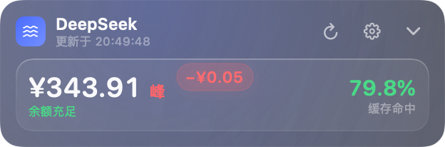
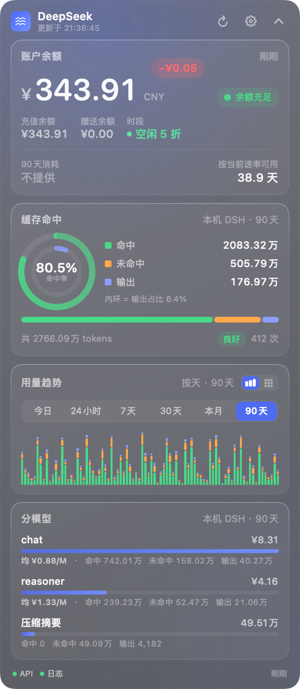

# DeepSeekFloat

> 把 DeepSeek 的余额和用量，放在桌面上一直看得见。
>
> 输入 API Key 看余额；再补一个平台令牌，就能看到 token 用量、缓存命中率和分模型明细。


DeepSeekFloat 由两块组成：一个无边框悬浮面板，显示余额、缓存命中和用量趋势；一个菜单栏图标，
常驻余额并收纳显隐、刷新、设置、置顶、开机自启。全部是原生 Swift，约 6000 行，
不需要完整 Xcode，Xcode Command Line Tools 就能编译。

[安装](#安装与平台状态) · [配置](#配置) · [常见问题](#常见问题) · [命令行](#命令行与调试) · [视觉细节清单](docs/视觉细节候选清单.md)

## 你可以做什么

| 能力 | 内容 |
| --- | --- |
| 余额 | 总额、充值 / 赠送拆分、可用状态、按当前速率估算的可用天数 |
| 峰谷时段 | 按北京时间判定，带切换倒计时；收起态在余额右边显示红「峰」绿「谷」 |
| 缓存命中 | 双同心环（外环命中率、内环输出占比）、三段构成条、请求次数、分级徽章 |
| 用量趋势 | 今日 / 24 小时 / 7 天 / 30 天 / 本月 / 90 天，柱状与热力两种画法 |
| 分模型 | 每个模型的 token、费用，以及每百万 token 平均费用 |
| 低余额提醒 | 面板呼吸红边加一声提示音，不走系统通知（原因见常见问题） |
| 菜单栏 | 常驻余额；点开可显隐、刷新、设置、置顶、开机自启、退出 |

用量和费用有两个来源，口径不一样：平台接口是账户全量、带真实金额；本机 DSH 日志只覆盖这台机器
发出的请求、没有金额。哪个都能用，但数字不能混着看，所以做成了显式选择。消耗速率是余额随时间的
下滑采样，只在 App 运行期间积累，属于估算，不是账单。

## 快速开始

需要 macOS 14 以上、Apple Silicon，以及 Xcode Command Line Tools。

```sh
git clone https://github.com/CasomTheseus/deepseek-float.git
cd deepseek-float
./build.sh install
```

1. 装完会自动启动，面板出现在屏幕右上角，菜单栏同时多一个余额。
2. 点面板右上角齿轮，第 ① 栏粘贴 `sk-` API Key，点「保存并测试」。
3. 想要用量数据，第 ② 栏选一个来源（默认「平台令牌」），按下面「配置」填。

`install` 会编译、装到 `/Applications`、然后启动。其它子命令：

```sh
./build.sh run          # 从 build/ 直接跑，不安装
./build.sh status       # 安装、运行、开机自启、凭据状态
./build.sh uninstall    # 卸载；加 --purge 连凭据和偏好一起删
./build.sh test         # 89 项断言
```

必须装到 `/Applications`。开机自启走 `SMAppService`，只认登记过的 bundle，
从 `build/` 里跑会报「系统找不到该 App」。

> 凭据存在 `~/Library/Application Support/DeepSeekFloat/credentials.json`，目录 0700、文件 0600。
> 没有任何遥测，只连 `api.deepseek.com` 和 `platform.deepseek.com`，外加可选的本机 DSH 日志。

## 安装与平台状态

| 项目 | 状态 |
| --- | --- |
| macOS 14 及以上 | 支持，本机 macOS 26.3 实测 |
| macOS 13 及更早 | 不支持。用了 `contentTransition(.numericText())`、`KeyframeAnimator` 这些 14 才有的动效 API |
| Apple Silicon | 支持 |
| Intel | 不支持。改 `build.sh` 里的 `SDK_TARGET` 为 `x86_64-apple-macos14.0` 可自行编译，我没测过 |
| macOS 26 的 Liquid Glass | 用不了。CommandLineTools 带的 SDK 是 15.5，没有相关符号，要装完整 Xcode 26 |
| 签名分发 | 没有。ad-hoc 签名，只在本机编译安装，没有 release 和 Homebrew |
| 系统通知 | 拿不到权限，见常见问题 |
| 开机自启 | 支持，前提是装到 `/Applications` |

## 配置

### API Key

在 platform.deepseek.com 建一个 `sk-` Key，设置页第 ① 栏粘贴，点「保存并测试」。

不想手输的话，「从 DSH 导入」会读本机 `~/.dsh/.credentials.yaml` 里已有的 Key，只读不写回。

### 用量来源

设置页第 ② 栏，三选一：

| 来源 | 范围 | 金额 | 需要令牌 |
| --- | --- | --- | --- |
| 平台令牌 | 账户全量，官方账单口径 | 有 | 要 `userToken` |
| DSH 本地日志 | 只算本机 DSH 用当前 Key 发出的请求 | 无 | 不要 |
| 不显示 | 只看余额 | — | 不要 |

当前来源会标在缓存卡和分模型卡右上角，比如「本机 DSH · 今日」，底栏徽章也会跟着变成「日志」。

**平台令牌**：登录 platform.deepseek.com/usage，F12 控制台执行
`JSON.parse(localStorage.getItem('userToken')).value`，把结果粘过来。
整串 `{"value":"…","expireAt":…}` 直接粘也行，会自动剥壳。

它是网页登录态，等价于账户读权限，别在公用电脑上用。

另外它是**账户**作用域。如果你用的 Key 是别人给的、自己登录的是另一个账户，这个来源给出的用量
跟那把 Key 没关系。这种就用下面那个。

**DSH 本地日志**：读 `~/.dsh/sessions` 下的会话日志，按请求统计本机 DSH 用当前 Key 发的调用。
不需要令牌，也不上传。需要 `brew install zstd`（系统不带 zstd，SDK 里也没有 libzstd）。

只覆盖 DSH 的流量。同一把 Key 在手机或其他客户端的调用不在这份日志里。

字段含义是验出来的，不是猜的。对全部真实记录跑

```
totalTokens == inputTokens + cacheReadTokens + outputTokens
```

都成立，所以 `cacheReadTokens` 是命中、`inputTokens` 是未命中、`outputTokens` 是输出。
压缩摘要这类调用没有模型归属，单独显示成「压缩摘要」。这条恒等式也写进了断言，
DSH 的日志格式将来变了会立刻暴露。

## 截图

截图来自 `--demo` 的示例数据（「本地日志来源」那张用 `--localsrc`），面板里的余额、用量、模型
都是合成的，没有使用真实凭据或真实账单。设置页那张是实时抓帧而不是离屏渲染，因为
`ImageRenderer` 画不出 AppKit 控件，Picker 和输入框会被画成 🚫。

| 展开态 | 收起态 |
| --- | --- |
|  |  |

| 设置页 | 没配置凭据时 |
| --- | --- |
|  |  |

| 高峰时段 | 空闲时段 |
| --- | --- |
|  |  |

用「DSH 本地日志」做来源时，消耗那一栏是「不提供」，模型里会多一条「压缩摘要」：



## 常见问题

### 为什么 API Key 查不到缓存命中和用量？

不是配置问题，是接口设计。余额接口认 `sk-` Key，用量接口认网页登录态 `userToken`，
拿 Key 去调用量接口稳定返回 `40003 invalid token`。

另外两个同生态的实现（[dsh-usage](https://github.com/Huasecc/dsh-usage)、
[dsh-deepseek-usage](https://github.com/AzureHalcyon/dsh-deepseek-usage)）踩的是同一个坑，
结论一样。

这个接口没公开，DeepSeek 随时可能改。解析器是按语义递归抓的，配了夹具测试，
形状微调不会直接把面板打空；但路径和字段名一起大改还是得跟着改。

### 为什么「消耗」显示「不提供」？

因为当前来源是「DSH 本地日志」，那份日志里只有 token 数，没有金额。

本来可以按官方价目乘一下算出来，但价目会变，而且按峰谷分档算出来的数字会显得比实际精确。
「命中率 + token 数」是日志里的一手事实，不需要任何假设，所以这里不给估值。
要看真实金额就切到「平台令牌」。

### 缓存命中率怎么算？还有哪些容易算错的地方？

- 命中率 = 命中 ÷ (命中 + 未命中)，只算输入侧。DeepSeek 的命中价和未命中价差一个数量级，
  这个比例比总 token 更能说明钱花得值不值
- 月度接口里 `total` 是全月总账、`days` 是同一批数据按天切的明细，相加会翻倍
- 费用接口的 `usage` 数组里混着 `REQUEST`（次数），算金额时得排除
- 平台按 UTC 切日，所以「今日」走带 `start/end/tz` 的窗口接口，
  否则 GMT+8 的 0 点到 8 点会被算进昨天
- 每百万 token 平均费用 = 实际费用 ÷ 实际 token × 100 万，从账单反推，不假设单价

### 为什么系统通知拿不到权限？

ad-hoc 签名的限制，不是配置问题。几个证据：

- App 内自报「通知权限：被拒绝」，但 `add()` 不报错，属于静默失败
- 本 App 的 bundle id 在 `com.apple.ncprefs.plist` 里根本没有记录，
  所以「系统设置 → 通知」里不会列出来，手动也打不开
- 换一个全新的 bundle id 重新 ad-hoc 签名安装，一样被拒

要真修好只能给 App 一个 Apple 签发的证书，本机自用不值得。

所以低余额提醒改成了不需要权限的通道：面板呼吸红边（琥珀色偏低，红色耗尽）加一声提示音。
窗口本来就常驻可见，比一条容易被错过的横幅可靠。

### 关掉「窗口永远置顶」之后窗口找不到了？

这是「不置顶」的定义，不是 bug。它会掉到别的窗口后面，包括全屏应用。

找回来：菜单栏 →「设置…」，或者点两次「显示 / 隐藏悬浮窗」。

切换时是主动 `orderBack` 把窗口送下去的。不这么做的话，这个 accessory app 的非激活面板
在别的 App 激活时并不会自动落到后面，`level = normal` 时它依旧压在整屏 Safari 上面，
等于开关没效果。这点专门测过。

### 为什么不用钥匙串存凭据？

因为 ad-hoc 签名每次重新编译 cdhash 都会变，钥匙串 ACL 会把新构建当成陌生程序，
反复弹窗甚至拒绝读取。凭据改成 0600 的普通文件，设置页有清除按钮。

### 峰谷时段什么时候会看错？

峰谷按官方定义判定：北京时间周一到周五 9:00–12:00、14:00–18:00 是高峰，其余时段空闲，
空闲价是高峰价的一半。跟本机时区无关。

已知的近似是中国法定节假日。离线没法可靠判断，所以节假日当天会被显示成高峰。
错得偏保守，不会让你误以为便宜。

### 有哪些没做的？

- 只读不写，没有预算硬闸，也不会自动充值
- 同时只允许一个实例，重复启动会自己退出
- 没有 CI。断言只在本机跑通，没有跨机器验证过
- 没有 release 和 Homebrew，也没有签名分发

## 命令行与调试

```sh
APP=build/DeepSeekFloat.app/Contents/MacOS/DeepSeekFloat

DSF_API_KEY=sk-xxx $APP --selftest    # 联网自检两条通路，不打印密钥
$APP --parsetest                      # 89 项断言
$APP --logtest                        # 读真实 DSH 日志打汇总

$APP --render out.png [--settings] [--collapsed] [--empty] [--daily]
                      [--bars|--heat] [--low] [--peak|--offpeak] [--localsrc]

kill -HUP $(pgrep -x DeepSeekFloat)    # 触发一次刷新
kill -USR1 $(pgrep -x DeepSeekFloat)   # 抓动画 0.10 / 0.45 / 1.10 秒三帧
kill -USR2 $(pgrep -x DeepSeekFloat)   # 让 App 自己发一条测试通知
kill -WINCH $(pgrep -x DeepSeekFloat)  # 切一次置顶，结果写 /tmp/dsf-top-report.txt
```

`--demo` 用示例数据跑界面，不联网也不读真实凭据。加 `--peak` 或 `--offpeak` 能强制显示另一种价签，
不然红「峰」得等到工作日 9 点。

环境变量也能给凭据：`DEEPSEEK_API_KEY` / `DSF_API_KEY`，`DEEPSEEK_USER_TOKEN` / `DSF_USER_TOKEN`。
界面保存的值优先。

这些信号入口是为了绕开两个问题。一是余额气泡只活 1.9 秒，真实扣费又是分钟级的，干等等不到。
二是本机没有屏幕录制权限，`screencapture` 直接报 `could not create image from display`，
`ImageRenderer` 只能出静态首帧。所以 `LiveCapture` 直接渲染自己的视图层级，不需要任何授权。

## 参考与致谢

没 fork 任何仓库。接口约定是从这几个实现里交叉验出来的：

- [KAPAIJUN/deepseek-usage-monitor](https://github.com/KAPAIJUN/deepseek-usage-monitor) —
  同样是 Swift + CommandLineTools 的菜单栏挂件，验证了工具链可行
- [Huasecc/dsh-usage](https://github.com/Huasecc/dsh-usage) —
  `usage/by_api_key/*` 的窗口接口和 WAF 请求头
- [AzureHalcyon/dsh-deepseek-usage](https://github.com/AzureHalcyon/dsh-deepseek-usage) —
  `total`/`days` 和 `REQUEST` 的处理，还有 `usage/export` 的 CSV 列名

想要菜单栏版或者网页内面板，上面几个可以直接用。

## 开发

```
DeepSeekFloat/
├── build.sh                         编译 / 运行 / 安装 / 打包 / 图标 / 测试
├── Resources/Info.plist             LSUIElement=true
├── Resources/AppIcon.icns           ./build.sh icon 生成
├── Sources/
│   ├── AppMain.swift                入口和各个 -- 子命令
│   ├── AppDelegate.swift            装配、信号入口
│   ├── AppModel.swift               状态、刷新调度、速率估算
│   ├── DeepSeekAPI.swift            两个域名、两条通路
│   ├── JSONValue.swift              容错解析
│   ├── DSHLogSource.swift           DSH 会话日志，用量来源之一
│   ├── CredentialStore.swift        0600 凭据文件
│   ├── FloatingPanelController.swift  面板、自适应高度、拖拽热区
│   ├── StatusItemController.swift   菜单栏
│   ├── Notifier.swift / LaunchAtLogin.swift
│   ├── Models.swift                 数据模型
│   ├── PeakSchedule.swift           峰谷判定
│   ├── VisualEffects.swift          噪点、余额气泡、对勾
│   ├── ParserTests.swift            夹具测试
│   ├── SelfTest.swift               联网自检
│   └── Views/
├── Tools/IconGen.swift              纯代码画图标
├── Tools/WindowProbe.swift          窗口几何探针
├── Tools/CropImage.swift            裁剪抓帧
└── docs/
```

几个实现上的坑：

- 内容高度通过 `reportHeight` 上报给 `NSPanel`，窗口自适应时保持顶边不动
- `ImageRenderer` 画不了 `ScrollView` 和 `NSViewRepresentable`，会成 🚫，
  所以视图里有个 `\.snapshotMode` 开关走等价路径
- 预览和渲染模式不写 `UserDefaults`，否则 `--render --collapsed` 会把真实配置改成收起

界面里那些微交互（气泡、数字滚动、双环、热力图）列在
[docs/视觉细节候选清单.md](docs/视觉细节候选清单.md)，里面还有没做的 17 条。

## License

MIT

## 更新日志

### v1.3 · 2026-10-21

用量来源改成三选一：平台令牌 / DSH 本地日志 / 不显示。

平台用量接口认的是网页登录态，属于账户作用域。别人给的 Key 配上你自己的账户，
那个接口返回的数字跟这把 Key 没关系，但两块数字并排摆着，看着像一套。
加本地日志源之后，这种情况可以直接读 `~/.dsh/sessions`，不需要账户级凭据。

日志字段的含义是对全部真实记录验出来的，也写进了断言。日志里没有金额，所以不做估算。

顺带修的：

- 分桶没补空桶，稀疏数据会让平均步长失真，热力图据此判断小时 / 天会判错。现在按日历铺满
- 示例数据的来源赋值顺序错了，`usageSource` 的 didSet 会清空 `usage`，放在造数据之后会把数据清掉
- 压缩摘要带 usage 但没有模型归属，单独标成「压缩摘要」而不是「未知模型」

新增 `--logtest`、`--localsrc`、`--settings`。

### v1.2 · 2026-10-21

柱状图加了逐根生长：切时间范围或首次显示时，每根柱子错开 18ms 从 0 长到目标高度，
90 天那种 84 根的把延迟封顶在 0.45 秒。

构成条流光其实 v1.0 就写进 `CompositionBar` 了，但一直没验收也没从待办里划掉，这次补了抓帧验证。

修了 demo 实例强制 `chartMode = .heat` 的问题，它一覆盖，示例数据就进不去柱状图。
新增 `Tools/CropImage.swift` 和 `kill -INFO` 柱状图探针。

### v1.1 · 2026-10-21

收起态余额右边加了峰谷单字价签，红「峰」绿「谷」，字号和金额一样大。
展开态「时段」那一项也改成同一套颜色。

修了重装后开机自启失效的问题：ad-hoc 签名每次编译 cdhash 都会变，
`SMAppService` 的注册会掉，现在 `install` 会记住原状态并在装完恢复。

### v1.0 · 2026-10-07

第一版。余额、缓存命中、趋势、分模型，两条凭据通路，无边框面板，菜单栏常驻，
开机自启，76 项断言起步。
